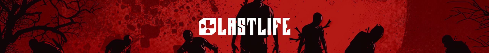

# Welcome to LastLife

The city fell. The dead walk. What's left of Los Santos belongs to whoever is willing to fight for it.

This guide teaches you how to stay alive: where it's safe, how to gather and craft, how to build a base, how to get stronger and who to trade with. It won't tell you everything. Some things are better found out the hard way.


**We're in Closed Beta.** Things change often. If something in this guide doesn't match the game, let us know in Discord.


## Where to start

| You want to... | Read |
| --- | --- |
| Take your first steps | [Getting Started](gameplay/getting-started.md) |
| Know where you can be shot | [Zones & PvP](gameplay/zones.md) |
| Get stronger | [How You Progress](gameplay/progression.md) |
| Learn the keys | [Controls & Commands](gameplay/controls.md) |
| Get materials and make things | [Gathering](gameplay/gathering.md) and [Crafting](gameplay/crafting-research.md) |
| Settle down | [Base Building](gameplay/base-building.md) and [Crews](gameplay/crews.md) |
| Get wheels | [Vehicles & Garages](gameplay/vehicles.md) |
| Risk it all | [The Subway](gameplay/subway.md) and [Airdrops](gameplay/airdrops.md) |

The server rules are in their own book, **Server Rules**. Read them before you pull a trigger.
